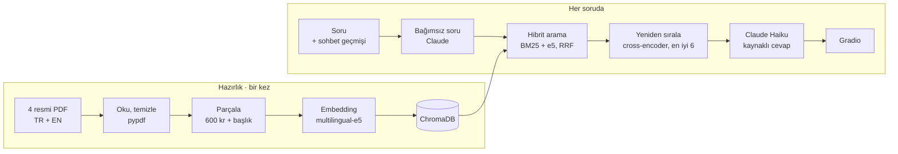

# Schengen Vize Asistanı

Türkiye'den **kısa süreli (C tipi) Schengen vizesine** başvuracak kişilere, özellikle öğrencilere, resmi belgelere dayanarak ve **kaynak göstererek** cevap veren bir RAG sohbet asistanı. Belgelerde olmayan bir şey sorulduğunda uydurmak yerine "bulamadım" der.


>
> ⚠️ Bilgilendirme amaçlıdır. Vize ücret ve şartları değişebilir; başvurudan önce ilgili konsolosluktan teyit edin.

## Neden?

Vize bilgisi dağınık: acente ve blog siteleri çelişkili ya da eski bilgi veriyor ve yanlış belge doğrudan ret sebebi olabiliyor. Bu asistan yalnızca AB ve konsoloslukların resmi belgelerinden cevap veriyor ve her bilginin hangi belgenin hangi sayfasından geldiğini gösteriyor.

## Mimari



| Katman | Araç | Ayar |
|---|---|---|
| PDF okuma | pypdf | Türkçe harf düzeltme, üst/alt bilgi temizliği |
| Parçalama | Cümle tabanlı | 600 karakter, 150 karakter örtüşme, her parçaya belge başlığı |
| Embedding | `intfloat/multilingual-e5-small` | 384 boyut, `query:` / `passage:` ön ekleri |
| Vektör veritabanı | ChromaDB | Kosinüs benzerliği |
| Kelime arama | BM25 | Türkçe için ilk 5 harf kökü |
| Birleştirme | Reciprocal Rank Fusion | BM25 + e5 sıralamaları |
| Yeniden sıralama | `cross-encoder/mmarco-mMiniLMv2-L12-H384-v1` | İlk 20 aday, belge başına en fazla 3 parça, K = 6 |
| Dil modeli | Claude Haiku 5.5 | Kaynak gösteren sistem istemi, takip sorusu dönüştürme |
| Arayüz | Gradio ChatInterface | Numaralı kaynaklar, katlanabilir parça listesi |

## Belgeler

| Belge | Kaynak | Dil | Rolü |
|---|---|---|---|
| Schengen genel rehberi (2025) | AB Türkiye Delegasyonu | TR | Genel kurallar, ücret, 90/180 gün |
| Türkiye ortak belge listesi (2021) | Avrupa Komisyonu | EN | Türkiye'deki tüm Schengen başvuruları için ortak belgeler |
| Öğrenci / eğitim programı checklist'i | Hollanda | EN | Erasmus ve öğrenci başvuruları |
| Turistik vize evrakları (2025) | İsviçre İstanbul Başkonsolosluğu | TR | Somut bir ülke örneği |

İndirme linkleri: [`veri/KAYNAKLAR.md`](veri/KAYNAKLAR.md). PDF'ler repoda yok; notebook ilk çalıştırmada kendisi indirir.

## Geliştirme süreci

İlk sürüm Türkçe sorularda İngilizce belgeleri bulamıyordu, çünkü BM25 kelime eşleştirdiği için "sigorta" ile "insurance"ı eşleştiremiyor. Erasmus sorusu (*"Erasmus için gideceğim, hangi belgeler gerekiyor?"*) üç sürümde:

| Sürüm | Değişiklik | Gelen parçalar | Sonuç |
|---|---|---|---|
| v1 | Şablon ayarları (K = 4) | 4 İsviçre | "Bilgi bulamadım"; öğrenci listesi hiç gelmedi |
| v2 | Parçalara Türkçe başlık + K = 6 | 6 Hollanda | Ayrıntılı liste ama tek kaynak |
| v3 | Belge başına en fazla 3 parça | 3 Hollanda + 1 AB ortak liste + 2 İsviçre | İki kaynağı birleştiren, kaynağını ayırt eden cevap |

Hibrit aramanın etkisi en net sigorta sorusunda görülüyor:

```
bm25          : isvicre-3 (TR) | isvicre-2 (TR)  | ab_rehberi-16 (TR)
e5            : isvicre-3 (TR) | isvicre-4 (TR)  | ogrenci_checklist-9 (EN)
hibrit+rerank : ogrenci_checklist-9 (EN) | isvicre-3 (TR) | isvicre-4 (TR)
```

BM25 yalnızca Türkçe belgeleri buldu, e5 anlama baktığı için İngilizce parçayı da yakaladı, yeniden sıralama 30.000 € teminat şartını içeren İngilizce parçayı birinci sıraya taşıdı.

Kapsam dışı sorular (ABD vizesi, belgelerde olmayan parmak izi kuralı) "bulamadım" ile cevaplanıyor; cevaptaki her kaynak kimliği bağlamdaki kimliklerle otomatik karşılaştırılıp uydurma kaynak işaretleniyor. 4 turlu bir sohbetin maliyeti yaklaşık 0,004 $.

## Çalıştırma

**Colab (önerilen):**
1. `schengen_vize_asistani.ipynb` dosyasını Colab'da açın.
2. Sol menüdeki 🔑 **Secrets** bölümüne `ANTHROPIC_API_KEY` ekleyin ve "Notebook access"i açın. Anahtar yoksa asistan yalnızca arama modunda çalışır.
3. *Çalışma zamanı → Tümünü çalıştır*. PDF'ler `veri/` klasörüne otomatik indirilir; bir site indirmeyi engellerse notebook linki gösterir, elle indirip aynı adla koyabilirsiniz.

**Yerel:**
```bash
pip install -r requirements.txt
export ANTHROPIC_API_KEY=...
jupyter notebook schengen_vize_asistani.ipynb
```

## Sınırlar ve geliştirme fikirleri

- Başarı birkaç örnek soruyla değerlendirildi; notebook'taki arama testi (hit@K) daha geniş bir soru setiyle genişletilmeli.
- Belgeler 2021–2025 tarihli; ücret ve şartlar değişebilir.
- Kullanıcı ülke belirtmezse ülkeye özel bilgi genel kural gibi algılanabilir.
- Fikirler: soruyu iki dilde (TR + EN) aramak, ülke filtresi (ChromaDB meta veri filtresi), ülke belirtilmediyse önce soru sormak, Haiku / Sonnet karşılaştırması, Hugging Face Spaces'e yayın.

## Teşekkür

*Büyük Dil Modelleri ve Gelişmiş NLP Uygulamaları* kariyer atölyesinde verilen RAG şablonu üzerine geliştirildi.
